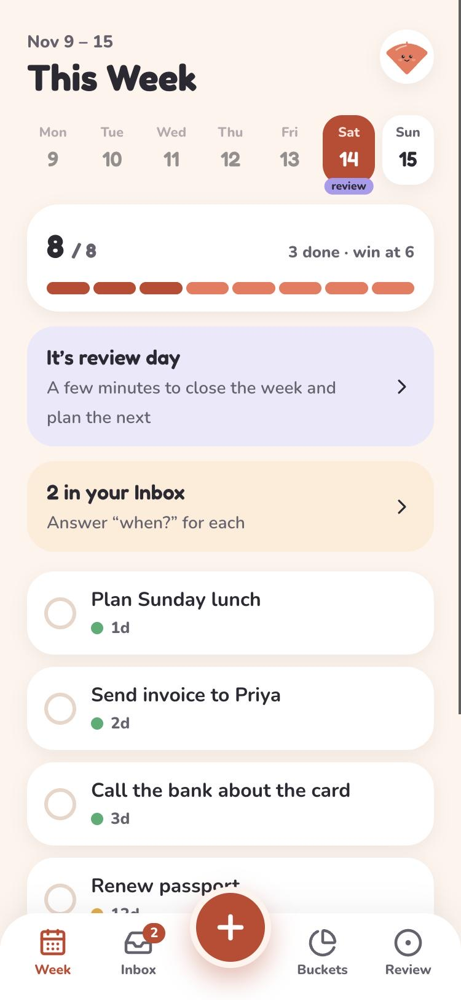
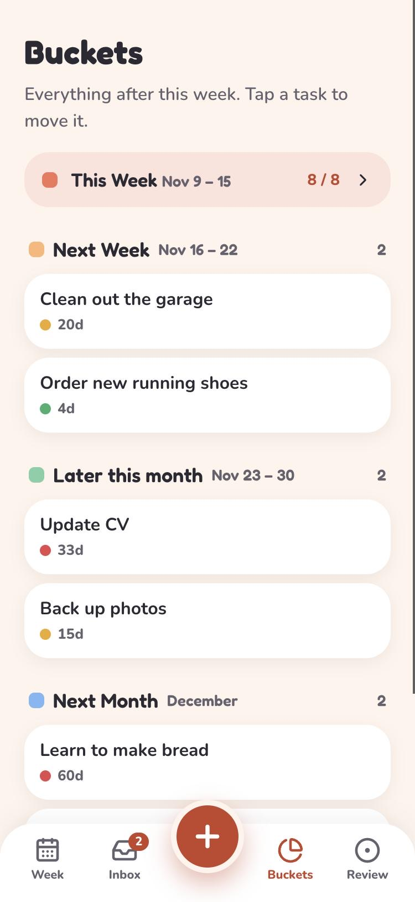
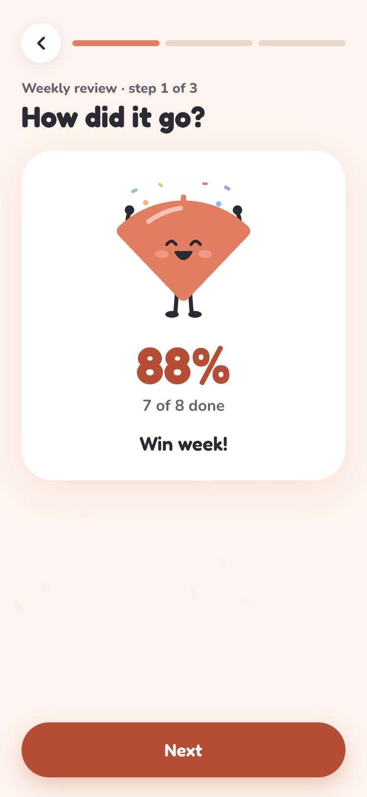
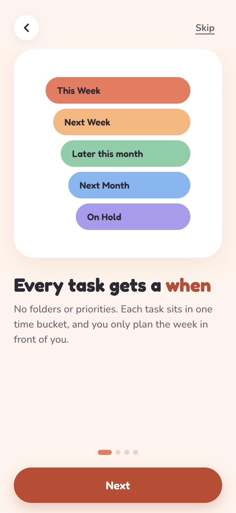

# Sector

**A playful task app built around your week.**

Sector is in testing. Try it out, use it for a couple of weeks, and share your feedback: it shapes what gets built next.

**Open it:** [sector-umber.vercel.app](https://sector-umber.vercel.app/), then [add it to your phone](#install-it-on-your-phone).

<p align="center">
  
  
  
  
</p>

## Why Sector

Most task apps are good at collecting tasks and bad at getting them done. Sector asks one question for every task: **when?** Each task goes into a time bucket, the current week has a limit, and a short weekly review keeps the plan honest.

- **Five buckets:** This Week · Next Week · Later this month · Next Month · On Hold
- **A limit set from real life:** the first week is a learning week with no limit. The first review suggests a limit from what actually got done. After that, adding past the limit means choosing what moves out.
- **A short weekly review:** three quick steps to close the week and plan the next one. Nothing rolls over on its own.
- **Age dots:** 🟢 under 7 days · 🟡 7–30 days · 🔴 over 30 days, so old tasks are easy to spot and let go.
- **80% is a win:** finishing most of the week counts as a good week.
- **Swipe to finish**, and pull in bonus tasks once the week is done.

## Install it on your phone

Sector is a web app that installs to the home screen. It opens full screen like any other app and works offline.

> **Install first, then set up.** Tasks are saved on the device, inside the app you set up in. On iPhone, the home-screen app and Safari keep separate data, so tasks added in a Safari tab won't appear in the installed app.

### iPhone and iPad

1. Open [sector-umber.vercel.app](https://sector-umber.vercel.app/) in **Safari**.
2. Tap the **Share** button (the square with an arrow pointing up). On iPhone it's at the bottom of the screen; on iPad it's at the top.
3. Scroll down and tap **Add to Home Screen**.
4. Keep the name "Sector" and tap **Add**.
5. Open Sector from the new icon on the home screen and follow the setup.

On iOS 16.4 or later, Chrome and Edge can do this too: tap Share in the address bar, then **Add to Home Screen**.

### Android

1. Open [sector-umber.vercel.app](https://sector-umber.vercel.app/) in **Chrome**.
2. Tap the **⋮** menu at the top right.
3. Tap **Add to Home screen** (on some phones it's called **Install app**), then **Install**.
4. Open Sector from the new icon on the home screen or in the app drawer and follow the setup.

Using **Samsung Internet**? Tap the **☰** menu at the bottom, then **Add page to** → **Home screen**.

### Good to know

- There are no accounts yet. Tasks stay on the device and never leave it.
- Clearing browser data, deleting the app or switching phones starts fresh.
- Add the weekly review to your calendar in **Settings** (or at the end of setup) to get a reminder on review day.

## Feedback

Feedback is the whole point of this testing phase. Tap **Send feedback** in **Settings** at any time. After the first two reviews, a card on This Week asks too. The form takes under a minute. It comes filled in with a few counts (weeks used, reviews done, this week's planned and done), and never your task names.

## Status

| Stage | Focus |
|---|---|
| **Prototype (now)** | Phone app with friends testing it: does the weekly limit and the weekly review work? |
| MVP | Core features from the PRD |
| Beta | Imports, calendar fit check, trends |
| Launch | Polish, landing page |

The full plan is in the [product requirements](PRD.md): the problem, users, requirements, flows, data model and roadmap.

## Run it locally

```bash
npm install
npm run dev
```

Open the address it prints. To try it on a phone on the same Wi-Fi, use the "Network" address. Offline support only runs in a production build (`npm run build && npm run preview`).

**Stack:** React 19 · Vite · Tailwind 4 · Motion · lucide-react · installable PWA, phone-first

## License

All rights reserved. The code is public to read, but not licensed for reuse.
